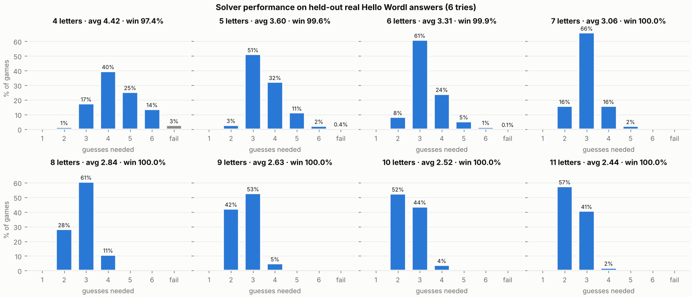

# Hello Wordl Solver (any length, 4–11 letters)

An information-theory solver and probability guide for [Hello Wordl](https://hellowordl.net),
the Wordle variant with any word length. It tells you the best word to play at every step
in milliseconds, and teaches you *why* with a data-driven strategy guide.

- **[STRATEGY_GUIDE.md](STRATEGY_GUIDE.md)**: best starting words per length, letter
  probabilities, signs to watch for (traps, doubles, endings), a human recipe.
- **Web solver** (`docs/index.html`): phone-friendly. Tap tiles to set colours, get the
  next guess instantly. Works offline: just open the file. To host it, turn on GitHub
  Pages (Settings → Pages → branch `main`, folder `/docs`).
- **Command line**: `python -m wordl play -n 7`.



## Results (held-out real Hello Wordl answers, 6 tries)

| letters | 4 | 5 | 6 | 7 | 8 | 9 | 10 | 11 |
|---|---|---|---|---|---|---|---|---|
| avg guesses | 4.42 | 3.60 | 3.31 | 3.06 | 2.84 | 2.63 | 2.52 | 2.45 |
| win rate | 97.4% | 99.6% | 99.9% | 100% | 100% | 100% | 100% | 100% |
| hard-mode win | 85.4% | 97.9% | 98.8% | 99.4% | 99.9% | 100% | 100% | 100% |
| best opener | SALE | TEARS | SATIRE | SALTIRE | NOTARIES | SARCOLINE | AEROLITICS | UNREALITIES |

Benchmark answers come from the half of Hello Wordl's public answer list that was **never**
used for calibration or tuning. 4-letter words are the hardest: many near-identical words
and only 6 tries. Hard mode here means "only guess words that could still be the answer",
which is stricter than the game's own hard mode.

## Quick start

```bash
pip install -r requirements.txt
python -m wordl play -n 5            # interactive: type the colours after each guess
python -m wordl suggest -n 5 tears:bbbbb could:bbgyb   # one-shot answer
python -m wordl openers -n 9         # best first words for 9 letters
```

Colours are typed one symbol per letter: `g` green, `y` yellow, `b` grey
(`2/1/0` and the 🟩🟨⬛ emoji also work). In `play` mode: `WORD COLOURS` if you played
something else, `!` if the game rejected the word, `?` lists the possible answers,
`u` undo, `n` new game.

## How it works

1. **Word list**: `data/raw/words.csv` (466k words) ∪ Webster's `data/raw/dictionary.csv`,
   case-insensitive and shown in CAPITALS.
2. **Prior**: each word gets P(answer) from its class: number of Webster definitions ×
   how often the word is *used* inside the 54k definitions (a word-frequency signal), plus
   plurals and inflections. Class weights are calibrated on half of Hello Wordl's public
   answer list (`scripts/calibrate.py`; only aggregate rates are stored).
3. **Feedback**: exact Hello Wordl colouring, including duplicate letters, vectorised in NumPy.
4. **Scoring**: for every allowed guess, candidates are grouped by the colour pattern they
   would produce. That gives the expected information (bits), P(win now), and an
   *expected number of guesses*. A small penalty steers it away from obscure words the
   game might reject.
5. **Endgame search**: with ≤80 candidates it searches 1–2 moves deep, solves the last two
   turns exactly, and adds a heavy penalty for running out of tries. That makes it spend a
   guess to escape traps like `_ACK` or `_IGHT`.
6. **Opening book**: the best opener and best reply to every likely first feedback are
   precomputed, so turns 1–2 are instant lookups; later turns take ~5 ms.

## Rebuilding everything

```bash
python scripts/calibrate.py          # downloads Hello Wordl's answer list, fits the prior
python scripts/build_all.py          # openers, opening books, stats, benchmark (~5 min, 4 cores)
python scripts/compare_openers.py 5  # "most frequent letters" vs information
python scripts/make_charts.py && python scripts/make_guide.py && python scripts/export_web.py
python -m pytest -q tests
```

## Files

| path | what |
|---|---|
| `wordl/` | solver package: `patterns.py` (feedback), `solver.py` (scoring + search), `lexicon.py`, `analysis.py`, `book.py`, `simulate.py`, `cli.py` |
| `docs/` | web solver (`index.html`, `app.js`, `data/len_XX.js`) |
| `STRATEGY_GUIDE.md` | the teaching guide |
| `output/reports/len_XX.md` | full per-length report: top 15 openers, pairs, letters, traps, first-feedback table |
| `output/openers.json` | ranked best first guesses per length |
| `output/opening_book/len_XX.json` | best 2nd guess for every first feedback |
| `output/analysis/len_XX.json` | all statistics behind the guide |
| `output/benchmark.json` | simulated games, every held-out answer |
| `output/opener_methods.txt` | letter-frequency vs information openers |
| `output/charts/` | charts |
| `data/lexicon/len_XX.tsv` | word lists with class + prior weight |
| `data/prior_calibration.json`, `data/benchmark_answers.json` | calibration + held-out test answers |
