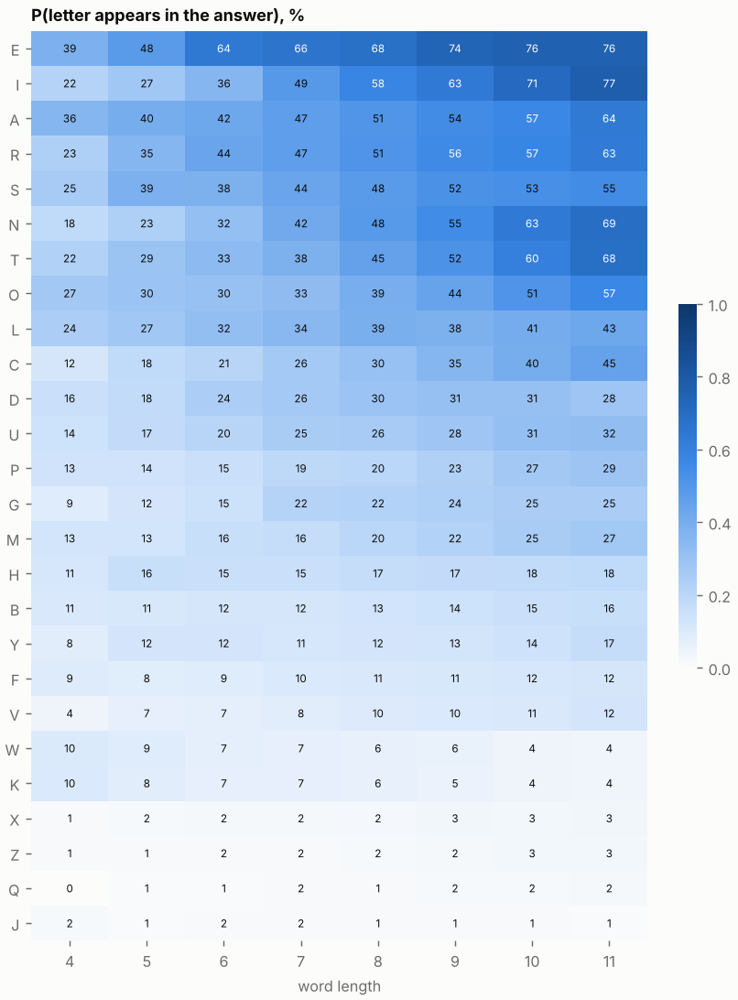
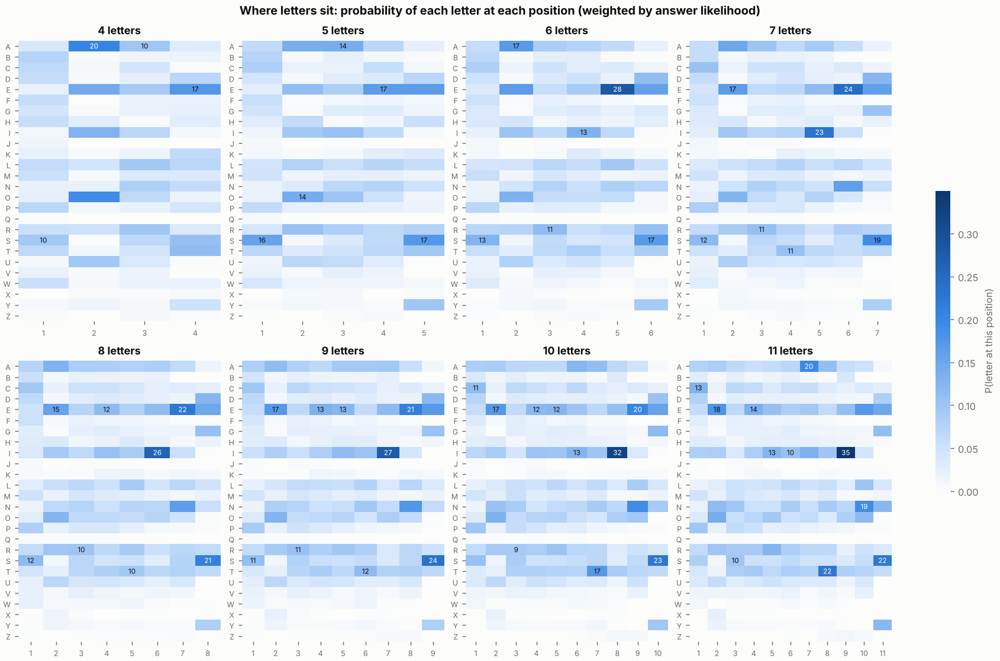
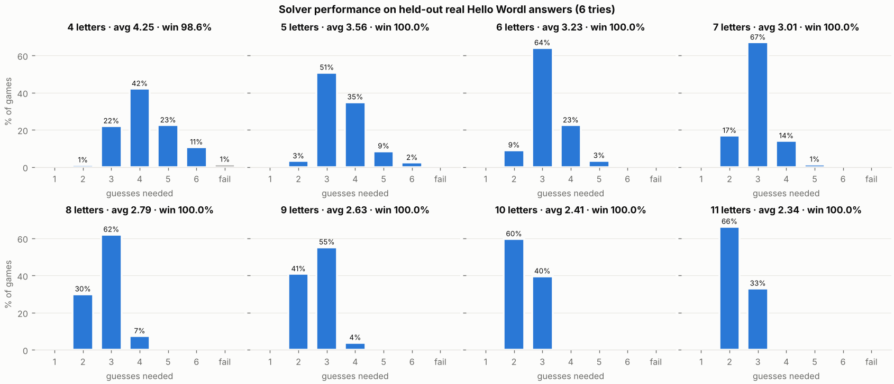

# How to win Hello Wordl at any length - a probability guide

Everything here is computed from the two word files in `data/raw/` (466k-word list + Webster's dictionary), weighted by how likely each word is to be the answer, and checked against real Hello Wordl answers the model never saw. Words are shown in CAPITALS; case never matters.

## 1. The rules that matter

- 4 to 11 letters, **6 tries at every length**.
- 🟩 green = right letter, right spot · 🟨 yellow = in the word, wrong spot · ⬛ grey = not in the word.
- **Duplicates:** greens are given out first, then yellows from left to right only while the answer still has unused copies. So if you guess two E's and get one 🟨 and one ⬛, the answer has **exactly one E**.
  Example: guess `EERIE`, answer `THERE` → 🟨⬛🟨⬛🟩.
- A word the game rejects ("not in word list") does **not** cost a try.

## 2. The one idea: every guess should split the possible answers as evenly as possible

Think of every guess as a question. A question whose answer you could have predicted teaches you nothing. A colour pattern that could come out hundreds of different ways teaches you a lot. That is measured in **bits**: each bit halves the number of possible answers.

| letters | possible answers* | bits needed | best opener gives |
|---|---|---|---|
| 4 | ~1,512 everyday words | ~10.6 | 4.6 bits |
| 5 | ~1,542 everyday words | ~10.6 | 6.2 bits |
| 6 | ~2,138 everyday words | ~11.1 | 7.5 bits |
| 7 | ~2,411 everyday words | ~11.2 | 8.9 bits |
| 8 | ~1,869 everyday words | ~10.9 | 10.1 bits |
| 9 | ~1,572 everyday words | ~10.6 | 10.9 bits |
| 10 | ~1,257 everyday words | ~10.3 | 11.1 bits |
| 11 | ~622 everyday words | ~9.3 | 11.4 bits |

\* everyday words, i.e. the likely answers. Longer words have more letters to test but **fewer** similar words, so they are actually *easier*: one good guess often leaves a handful.

## 3. Is the best first word just "the most common letters"? No

That's the usual human rule, and it's a decent start, but it is beaten at most lengths. Here are three ways to pick a first word ("left" = average possible answers remaining after it):

| letters | most frequent letters | frequent letters in usual spots | **information (solver)** |
|---|---|---|---|
| 4 | ALOE · 4.25 bits · 322 left | SALE · 4.57 bits · 264 left | **SALE · 4.57 bits · 264 left** |
| 5 | TEARS · 6.17 bits · 246 left | CRIES · 5.80 bits · 312 left | **TEARS · 6.17 bits · 246 left** |
| 6 | SATIRE · 7.54 bits · 141 left | SORTED · 7.28 bits · 174 left | **SATIRE · 7.54 bits · 141 left** |
| 7 | SALTIRE · 8.92 bits · 78 left | PARTIES · 8.88 bits · 78 left | **SALTIRE · 8.92 bits · 78 left** |
| 8 | ENTRAILS · 9.76 bits · 50 left | COUNTIES · 9.77 bits · 52 left | **CURTAINS · 9.88 bits · 47 left** |
| 9 | DOCTRINES · 10.74 bits · 24 left | COMPANIES · 10.51 bits · 29 left | **CENTURIES · 10.86 bits · 20 left** |
| 10 | INTRODUCES · 10.91 bits · 12 left | DECORATING · 11.01 bits · 11 left | **MERCANTILE · 11.15 bits · 10 left** |
| 11 | PERSONALITY · 11.18 bits · 6 left | PERSONALITY · 11.18 bits · 6 left | **PERSECUTION · 11.27 bits · 5 left** |

Why frequency alone isn't enough:

1. **A letter is most useful when it's in about half the words.** In 8+ letter words E is in ~66% of answers, so learning "yes, there's an E" is less informative than a letter present in ~50%.
2. **Common letters overlap.** A, O and E tend to appear in the *same* words, so testing all three is partly redundant (ALOE loses to SALE for 4 letters).
3. **Position matters.** S is the most common first letter and E/S/Y are common last letters: a letter in its usual spot often lands a green, which eliminates far more than a yellow.
4. **After turn 1, frequency stops working at all.** The best 2nd/3rd guess often uses letters you already know are wrong, purely to split the remaining candidates.

## 4. Best starting words

| letters | best overall | best everyday word | best fixed pair (play both) | avg answers left after the opener |
|---|---|---|---|---|
| 4 | **SALE** | SALE | SALE + TORN | 264 |
| 5 | **TEARS** | TEARS | LARES + POINT | 246 |
| 6 | **SATIRE** | SATIRE | SALTER + CONIUM | 141 |
| 7 | **SALTIRE** | SALTIRE | PARTIES + GUNLOCK | 79 |
| 8 | **NOTARIES** | CURTAINS | REALTIES + COMPOUND | 37 |
| 9 | **NECTARIES** | CENTURIES | CENTURIES + GALLOPADE | 18 |
| 10 | **MERCANTILE** | MERCANTILE | REPLICATES + DIMINUTION | 10 |
| 11 | **UNREALITIES** | PERSECUTION | PERSECUTION + ANNIHILATED | 5 |

Runners-up (any of these is within a hair of the best):

- **4:** TALE, SATE, SEAL, SEAT, LEAS, RASE, LATE
- **5:** SLATE, LARES, STARE, RATES, TALES, TRIES, RALES
- **6:** SALTER, SAILER, SALINE, SERIAL, RATELS, SALTED, SORTED
- **7:** PARTIES, SALTIER, SARDINE, RETAINS, RETAILS, RENTALS, RATLINS
- **8:** REALTIES, CURTAINS, LATRINES, RATLINES, ARTICLES, GANTRIES, RETINALS
- **9:** CENTURIES, COUNTRIES, PENALTIES, LARCENIES, REACTIONS, AEROLITES, DOCTRINES
- **10:** NORMALCIES, TOURMALINE, REPLICATES, DIRECTIONS, REGALITIES, LACUSTRINE, RECEPTIONS
- **11:** PERSECUTION, AERONAUTICS, ULCERATIONS, CUSTOMARILY, ROTUNDITIES, LEGIONARIES, DESCRIPTION

If the game rejects a word (it happens with rarer ones), just use the next one in the list.

## 5. Letter probabilities to memorise

| letters | top letters (P in answer) | P(repeated letter) | most likely last letter |
|---|---|---|---|
| 4 | E39 A36 O27 S25 L24 R23 T22 I22 | 19% | E 17%, T 11%, S 11% |
| 5 | E48 A40 S39 R35 O30 T29 I27 L27 | 31% | S 17%, E 17%, Y 10% |
| 6 | E64 R44 A42 S38 I36 T33 L32 N32 | 52% | S 17%, E 16%, D 11% |
| 7 | E66 I49 R47 A47 S44 N42 T38 L34 | 66% | S 19%, E 16%, D 12% |
| 8 | E68 I58 R51 A51 N48 S48 T45 O39 | 79% | S 21%, E 15%, D 12% |
| 9 | E74 I63 R56 N55 A54 S52 T52 O44 | 89% | S 24%, E 17%, D 12% |
| 10 | E76 I71 N63 T60 R57 A57 S53 O51 | 95% | S 23%, E 15%, G 12% |
| 11 | I77 E76 N69 T68 A64 R63 O57 S55 | 98% | S 22%, E 15%, Y 12% |

Patterns worth knowing:

- **Repeated letters are common** and get more common with length (see the table). If you're stuck with few letters found, suspect a double.
- **Endings carry a lot of probability in long words:** 7: -ING, -ERS, -TED, -OUS; 8: -ING, -ESS, -TED, -ATE; 9: -ING, -ION, -TED, -ESS; 10: -ING, -ION, -OUS, -ESS; 11: -ING, -ION, -ENT, -TED
- **4-5 letters** are the hardest: many near-identical words (see traps below) and only 6 tries.

## 6. Signs to watch for

### After your first guess

Using the best 5-letter opener **TEARS** as the example (every length has its own table in `output/reports/`):

| greens | yellows | how often | avg answers still possible |
|---|---|---|---|
| 0 | 0 | 6% | 718 |
| 0 | 1 | 19% | 506 |
| 0 | 2 | 22% | 242 |
| 0 | 3 | 8% | 97 |
| 0 | 4 | 2% | 25 |
| 1 | 0 | 8% | 370 |
| 1 | 1 | 15% | 175 |
| 1 | 2 | 9% | 58 |
| 1 | 3 | 2% | 15 |
| 2 | 0 | 4% | 99 |
| 2 | 1 | 3% | 28 |

- **All grey is not bad news**: it happens often and still removes most words. Play a second word with five *new* common letters.
- **One green is worth about two yellows.** Greens pin a position; yellows only rule one out.
- **Many yellows** (3+) means the letters are right but scrambled: few words fit, so start guessing real candidates.

### Trap families - the #1 way to lose

A trap is a set of words that differ in a single position. Guessing them one by one can take more tries than you have.

- **4 letters** (62% of everyday words are in a family of 4+): `_INE` → DINE FINE KINE LINE MINE NINE PINE SINE; `_EAR` → BEAR DEAR FEAR GEAR HEAR NEAR PEAR REAR; `_ARE` → BARE CARE DARE FARE HARE MARE PARE RARE
- **5 letters** (10% of everyday words are in a family of 4+): `_IGHT` → EIGHT FIGHT HIGHT LIGHT MIGHT NIGHT RIGHT SIGHT; `_OUND` → BOUND FOUND HOUND MOUND POUND ROUND SOUND WOUND; `_ATCH` → CATCH HATCH LATCH MATCH PATCH WATCH
- **6 letters** (3% of everyday words are in a family of 4+): `_ALLOW` → FALLOW MALLOW SALLOW TALLOW WALLOW; `_UMBLE` → FUMBLE HUMBLE JUMBLE RUMBLE TUMBLE; `_ATHER` → FATHER GATHER LATHER RATHER
- **7 letters** (3% of everyday words are in a family of 4+): `_EARING` → BEARING GEARING HEARING REARING TEARING WEARING; `HEA_ING` → HEADING HEALING HEAPING HEARING HEATING HEAVING; `LEA_ING` → LEADING LEAKING LEANING LEAPING LEAVING

**What to do:** if the possible answers outnumber your remaining tries and they differ in one spot, spend a guess on a word (even an impossible one) containing as many of the competing letters as you can. Example: `_IGHT` with F, L, M, N, R, S, T, W possible → a word like FLOWN or NYMPH tests several at once.

### Other signs

- **Yellow + grey of the same letter** → exactly that many copies, no more.
- **A yellow letter must move.** Never put it back in the same spot; in hard mode the game forces you to reuse it.
- **Few vowels found by turn 2** → check Y, and words with one vowel repeated.
- **Long words (8+)**: after the first guess, look at the end of the word: -ING, -ED, -ER, -TION, -NESS, -ABLE and plural -S decide a big chunk of the answer.
- **Two candidates left** → guess the more common word. **Three+ left with turns to spare** → a splitting word beats guessing a candidate.

## 7. Human strategies, tested

Each strategy below was played on every held-out real answer. Cells show **average guesses · win rate** (6 tries). The "frequency pair" is the two words made of the most common letters (second word = the most common *new* letters).

| letters | frequency pair | pair, guess if 2+ revealed | pair, guess if 3+ revealed | always play both words | one word, then guess | pair if <2 revealed, then keep-hits + common letters | one word, then keep-hits + common letters | SOLVER (information) |
|---|---|---|---|---|---|---|---|---|
| 4 | ALOE + STIR | 4.96 · 82.7% | 4.89 · 85.0% | 4.89 · 85.1% | 5.26 · 76.7% | 4.84 · 85.9% | 4.88 · 85.3% | 4.25 · 98.6% |
| 5 | TEARS + LOGIC | 3.77 · 98.5% | 3.81 · 98.6% | 3.85 · 99.0% | 3.82 · 98.3% | 3.84 · 97.8% | 3.81 · 97.6% | 3.56 · 100.0% |
| 6 | SATIRE + COLUMN | 3.38 · 99.1% | 3.37 · 99.3% | 3.45 · 99.2% | 3.41 · 99.0% | 3.40 · 99.1% | 3.41 · 99.0% | 3.23 · 100.0% |
| 7 | SALTIRE + GUNLOCK | 3.07 · 99.8% | 3.11 · 99.8% | 3.38 · 99.9% | 3.06 · 99.8% | 3.15 · 99.5% | 3.15 · 99.5% | 3.01 · 100.0% |
| 8 | ENTRAILS + PLUMBAGO | 2.87 · 99.9% | 2.87 · 100.0% | 3.25 · 100.0% | 2.86 · 99.9% | 2.97 · 99.8% | 2.96 · 99.8% | 2.79 · 100.0% |
| 9 | DOCTRINES + SUBFAMILY | 2.71 · 100.0% | 2.72 · 100.0% | 3.10 · 100.0% | 2.71 · 100.0% | 2.81 · 100.0% | 2.81 · 100.0% | 2.63 · 100.0% |
| 10 | INTRODUCES + BANKRUPTCY | 2.59 · 100.0% | 2.59 · 100.0% | 3.17 · 100.0% | 2.59 · 100.0% | 2.69 · 100.0% | 2.69 · 100.0% | 2.41 · 100.0% |
| 11 | PERSONALITY + DISGRACEFUL | 2.37 · 100.0% | 2.37 · 100.0% | 3.06 · 100.0% | 2.37 · 100.0% | 2.45 · 100.0% | 2.45 · 100.0% | 2.34 · 100.0% |

What this shows:

- **Short words (4-5 letters): simple rules lose games.** Many near-identical words means guessing "the most common word that fits" walks you into traps; the solver's probe words are what keep the win rate near 100%.
- **Long words (8+): almost any sensible start works.** One frequency word usually leaves a handful of words, so starting to guess immediately is close to optimal.
- **Don't burn a second fixed word on long words** - it costs about half a guess.

## 8. A simple human recipe

1. Turn 1: play the opener for your length (table above).
2. Turn 2: if you got ≤1 hit, play the fixed partner word (new letters). Otherwise pick a word that keeps your greens, moves your yellows and adds new common letters.
3. Turn 3+: count the words that still fit. If ≤ remaining tries, guess the most common one. If more, play a splitting word first (see traps).
4. Use the solver (`python -m wordl play -n 7` or the web page) to check yourself; it shows the best word *and why* (expected guesses, bits, chance to win now).

## 9. How good is the algorithm?

Tested on real Hello Wordl answers it **never saw during tuning** (held-out half), 6 tries:

| letters | games | avg guesses | win rate | hard-mode avg | hard-mode win |
|---|---|---|---|---|---|
| 4 | 652 | **4.25** | **98.6%** | 4.60 | 89.4% |
| 5 | 712 | **3.56** | **100.0%** | 3.66 | 98.6% |
| 6 | 1012 | **3.23** | **100.0%** | 3.29 | 99.6% |
| 7 | 1057 | **3.01** | **100.0%** | 3.06 | 99.6% |
| 8 | 980 | **2.79** | **100.0%** | 2.81 | 99.9% |
| 9 | 903 | **2.63** | **100.0%** | 2.65 | 100.0% |
| 10 | 724 | **2.41** | **100.0%** | 2.43 | 100.0% |
| 11 | 472 | **2.34** | **100.0%** | 2.36 | 100.0% |

Speed: turns 1-2 are instant lookups (precomputed opening book); later turns are computed live in milliseconds (Python ≈ 6 ms worst average; the browser version is similar).

## 10. How the algorithm works

1. **Prior** - every word gets P(answer). Class = Webster definitions count × how often the word is *used* inside the 54k definitions (a word-frequency signal), plus plurals/inflections. Class weights are calibrated on half of Hello Wordl's public answer list (`scripts/calibrate.py`). Only words the game accepts are kept, so names (JAMEL, PATEL) and abbreviations never count as possible answers.
2. **Feedback** - exact Hello Wordl colouring including duplicates, vectorised with NumPy.
3. **Score every guess** - group all candidates by the pattern they'd produce, then compute information (entropy), P(win now) and an *expected number of guesses* E = 1 + Σ P(pattern) × F(bits left in that group).
4. **Endgame search** - with ≤80 candidates it searches the game tree 1-2 moves deep, solving the last two turns exactly and adding a heavy penalty for running out of tries, so it sacrifices a guess to escape traps.
5. **Opening book** - best first word and the best reply to every likely first feedback are precomputed.
6. **Tuning** - prior strength, fail penalty and search width were tuned on the training half only.
